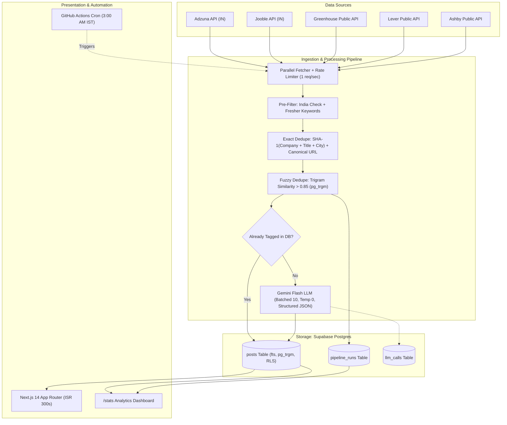

# System Architecture

Fresher Jobs India is built as an end-to-end automated platform that ingests, filters, deduplicates, enriches, and presents fresher tech positions across India.



---

## Component Layers

### 1. Ingestion Layer (`/pipeline/sources`)
- **Parallel Fetching**: Sources are fetched concurrently via `Promise.allSettled`.
- **Fault Isolation**: Each source is an isolated module returning `RawPost[]`. Any failure is logged and recorded in `pipeline_runs.errors` without halting other sources.
- **Rate-Limiter**: Enforces a minimum interval of 1000ms per host with exponential backoff on 429/5xx codes.

### 2. Pre-filter Layer (`/pipeline/prefilter.ts`)
- Evaluates candidate postings without LLM cost:
  - **Location Check**: Matches India, Indian metropolitan areas, or Remote/WFH keywords while dropping foreign-only locations.
  - **Fresher Verification**: Matches positive entry-level keywords (`fresher`, `intern`, `trainee`, `graduate`, `entry level`, `0-1 yrs`, `0-2 yrs`) and suppresses senior roles.

### 3. Deduplication Engine (`/pipeline/dedupe.ts`)
- **Canonical URLs**: Strips tracking query parameters (`utm_*`, `ref`, `gh_src`, etc.).
- **Exact Matching**: Computes `sha1(normalize(company) + normalize(title) + normalize(canonical_city))` and matches canonical apply URLs.
- **Fuzzy Trigram Matching**: Computes string similarity matching PostgreSQL `pg_trgm.similarity()`. Postings with identical normalized companies and title similarity > 0.85 are marked as duplicates, pointing `duplicate_of` to the canonical post ID.

### 4. Classification & LLM Enrichment (`/pipeline/tag.ts`)
- **Model**: `gemini-2.5-flash` via official `@google/genai` SDK.
- **Batching**: Groups 10 posts per prompt with structured JSON output and `temperature: 0`.
- **Dedupe Key Cache**: Inspects database for pre-existing tags by `dedupe_key` before dispatching LLM calls. Existing records are never retagged.
- **Token Auditing**: Writes prompt and candidate token counts to `llm_calls`.

### 5. Database Schema & Row-Level Security (`/supabase/schema.sql`)
- **Tables**:
  - `posts`: Master jobs table with generated tsvector `fts` column, GIN indexes, and trgm index.
  - `pipeline_runs`: Operational logs with fetched counts, dedupe stats, and source breakdowns.
  - `llm_calls`: Granular token and model auditing for cost analysis.
  - `hand_check`: Ground-truth evaluation table for tagging accuracy checks.
- **RLS**: Public read-only access is restricted to:
  ```sql
  create policy "public read active" on posts for select
  using (is_active = true and is_fresher = true and duplicate_of is null);
  ```

### 6. Web Application (`/app`)
- Built on Next.js 14 App Router with Tailwind CSS.
- Incremental Static Regeneration (`revalidate = 300`) caches pages at the edge.
- Client search bar synchronizes with URL parameters, enabling full-text search and multi-filtering across roles, cities, sources, and recency.
- Dedicated `/stats` page provides a real-time analytics dashboard for demo presentations.
